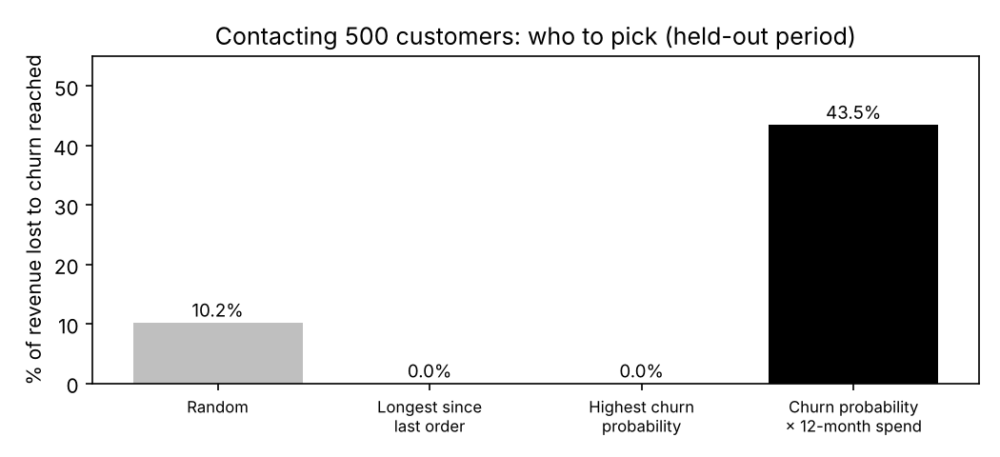
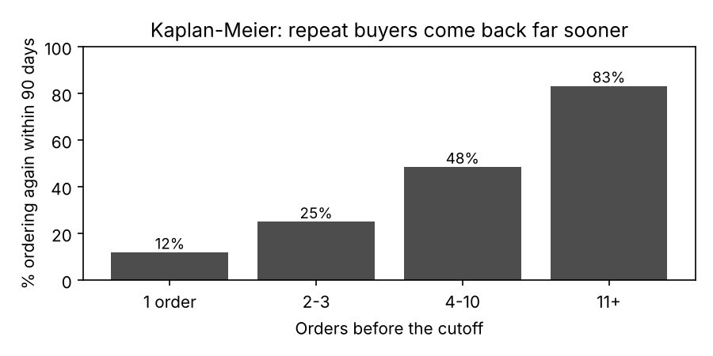

# Customer Retention & Lifetime Value

Who will stop buying, what each customer is worth, and who to contact first, for the 5,852 customers of a real
UK online gift retailer, served through an API and an LLM analyst agent that may only quote numbers from its tools.

**What it shows**
- **Targeting by value, not by risk.** With 500 contacts, ranking by churn probability alone reaches **0%** of the revenue lost
  to churn: its top picks left more than a year ago and spend nothing. Ranking by churn probability × 12-month spend reaches
  **43.5%** (random contacts: 10.2%).
- **Out-of-time churn model.** Trained on customers as of 2010-11-29, tested on customers as of 2011-06-05.
  Logistic regression (chosen on validation) reaches **ROC-AUC 0.8044** and beats LightGBM by
  0.016 (95% CI 0.008 to 0.023).
- **A known model failure, measured.** BG/NBD gives every one-time buyer a 100% chance of still being active, yet
  72.8% of them never return; as a churn score it is worse than chance (AUC 0.4426).
- **An honest test plan.** The data has no randomised campaign, so the offer's uplift is unknown. A 250 / 250 test on the priority
  list could only detect a **11.3 pp** retention lift; detecting 5 pp needs **1,363 customers per arm**.



## Data
UCI Online Retail II (Chen, 2012, CC BY 4.0), lines with a customer ID: 824,364 → 776,579 after removing
cancellations (18,744), zero prices, fee codes and 26,055 duplicates. 36,594 orders, 2009-12-01 to 2011-12-09.
Cancellations are kept separately to build a returns-rate feature. `scripts/get_data.sh` fetches the data.

## 1. Lifetime value (BG/NBD), calibration to 2011-06-05, holdout 188 days
| Check | Model | Baseline |
|---|---|---|
| Total repeat orders | 7,832 predicted vs 8,018 actual | |
| MAE per customer (orders) | 1.075 | 1.118 (past order rate) |
| Spearman, predicted vs actual revenue | 0.63 | 0.566 (last 188 days' revenue) |
| Holdout revenue from the predicted top 10% | 61.5% | 59.4% |

The Gamma-Gamma order-value model fitted q = 0.889 (q ≤ 1 means its prior has no finite mean, which first produced
negative revenue forecasts), so order value is each customer's observed mean shrunk toward the population median instead.
BG/NBD does not converge on the earlier, shorter history without a larger penalty; the fitter steps the penalty up and records it.

## 2. Churn (no order in the next 188 days), out-of-time test
Churn rate: 50.7% (train), 47.4% (test). One-time buyers churn 72.8%; repeat buyers 35.0%.

| Model | ROC-AUC | PR-AUC | Brier | ECE |
|---|---|---|---|---|
| **Logistic regression (champion)** | **0.8044** | 0.7578 | 0.19 | 0.0969 |
| LightGBM | 0.7887 | 0.7439 | 0.1905 | 0.0622 |
| LightGBM + isotonic calibration | 0.7852 | 0.7174 | 0.1921 | 0.0662 |
| BG/NBD (1 − P(alive)) | 0.4426 | 0.5397 | 0.4012 | 0.382 |

Champion chosen on a validation split of the training customers (AUC 0.7975 vs 0.7784).
15 features (recency, frequency, tenure, spend, gaps between orders, returns rate, ...), all computed from data before the cutoff (tested).

## 3. Time to next order (Kaplan-Meier, Cox)
| Orders before cutoff | Customers | Ordering again within 90 days | Median days to next order |
|---|---|---|---|
| 1 order | 1,609 | 11.9% | not reached in 188 days |
| 2-3 | 1,442 | 25.0% | not reached in 188 days |
| 4-10 | 1,413 | 48.5% | 95.0 |
| 11+ | 457 | 83.2% | 17.0 |

Cox model (concordance 0.745): each log-unit of order frequency multiplies the reorder rate by
1.90 (95% CI 1.77–2.04); each log-unit of days since the last
order multiplies it by 0.78. Returns rate and UK vs non-UK were not significant. The proportional-hazards
assumption was not formally tested.



## 4. Segments as of 2011-12-10
| Segment | Customers | Avg churn probability | Revenue, last 12 months | Share |
|---|---|---|---|---|
| high value at risk | 9 | 0.57 | £17,324 | 0.2% |
| high value stable | 1,162 | 0.09 | £6,798,434 | 80.7% |
| low value at risk | 2,668 | 0.76 | £319,052 | 3.8% |
| low value stable | 2,013 | 0.29 | £1,294,114 | 15.3% |

High value = top 20% by 12-month revenue; at risk = churn probability ≥ 0.5.

## 5. LLM analyst agent
Five tools (`list_segments`, `get_segment_summary`, `get_customer`, `get_top_priority`, `get_test_design`) behind FastAPI and an
OpenAI-compatible tool-calling loop (default: Ollama on localhost). A verifier checks every number in an answer against the tool
results; the agent must refuse questions the data cannot answer, such as how much an offer *will* save.
`eval/questions.jsonl`: 30 questions (24 with known answers, 6 that must be refused).
```bash
bash scripts/run_agent_eval.sh      # qwen2.5:7b via Ollama, with and without the verifier
```
CI runs the harness with a scripted keyword router to test the plumbing; that is not a model result. LLM results: _pending a local run_.

## Run
```bash
pip install -e ".[dev]"
bash scripts/get_data.sh
python -m crc.run && python -m crc.charts     # ~2 min
pytest -q                                     # 8 tests
uvicorn crc.api:app --port 8080               # /health /segments /customers/{id} /priority /test-design /predict
```

## Limitations
- Wholesale-heavy customer base; one test cutoff; a 188-day churn window.
- The value-at-risk ranking is judged on who actually churned. Whether an offer would have kept them is unknown without a test.
- Logistic regression is less well calibrated out of time (ECE 0.0969) than LightGBM (0.0622) because the base churn
  rate moved between cutoffs; recalibrating on recent data is the next step.
